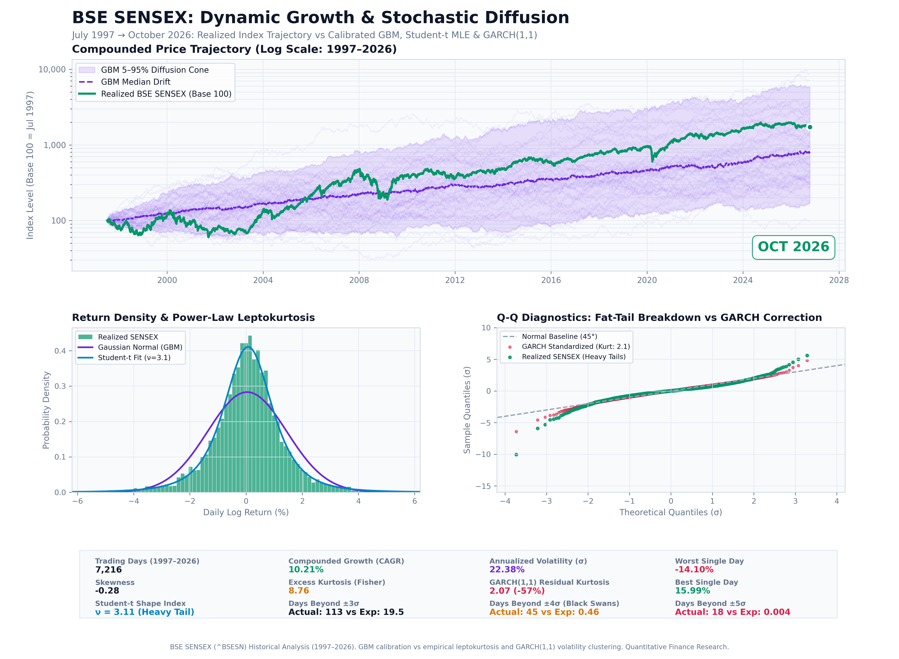
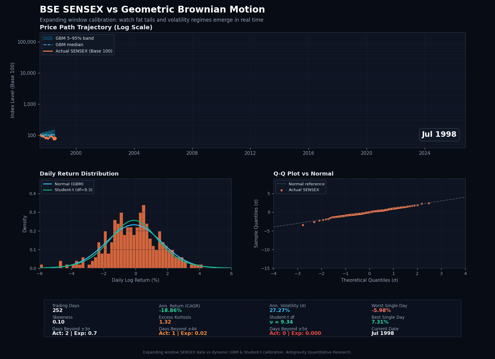

# BSE SENSEX vs Geometric Brownian Motion (GBM)
### Quantitative Modeling of Fat Tails, Volatility Clustering, and Stochastic Drift (1997–2026)

An independent quantitative investigation benchmarking 29+ years of empirical daily market data from the **BSE SENSEX** (India's premier benchmark index) against stochastic **Geometric Brownian Motion (GBM)**, featuring econometric extensions: **Student-t heavy-tail estimation** and **GARCH(1,1) volatility clustering**.

---

## 🌐 Live Localhost Dashboards

The application servers are configured and running locally:

| Dashboard | Local URL | Description |
| :--- | :--- | :--- |
| **Interactive Web Visualizer** | **[http://localhost:8000](http://localhost:8000)** | Standalone dark-mode HTML5/Canvas dashboard with timeline scrubber, play/pause controls, and model toggles. |
| **Streamlit Quantitative App** | **[http://localhost:8501](http://localhost:8501)** | Full quantitative workbench with Monte Carlo path sliders, confidence interval bands, and Plotly analytics. |

> To launch anytime from terminal or Windows:
> - **Web Visualizer**: `python -m http.server 8000` $\to$ navigate to [http://localhost:8000](http://localhost:8000)
> - **Streamlit App**: `streamlit run app.py` $\to$ navigate to [http://localhost:8501](http://localhost:8501)
> - Or double-click `run_dashboard.bat`.

---

## 📊 Publication Visualizations

### 1. High-Resolution Quantitative Infographic

### 2. Time-Evolution Simulation (1998–2026)

---

## 📌 Core Quantitative Findings

Empirical evaluation of **7,216 trading days** (July 1997 – October 2026):

| Metric | Empirical SENSEX | Gaussian GBM Expectation | Student-t MLE / GARCH(1,1) |
| :--- | :---: | :---: | :---: |
| **Trading Days** | **7,216** (1997–2026) | 7,216 | 7,216 |
| **Annualized Return (CAGR)** | **10.21%** | 10.21% (calibrated drift) | Inside 5–95% GBM ribbon |
| **Annualized Volatility ($\sigma$)** | **22.38%** | 22.38% (constant $\sigma$) | Conditional $\sigma_t$ via GARCH |
| **Excess Kurtosis** | **8.76** (Severe Leptokurtosis)| **0.00** (Gaussian Normal) | Standardized Residuals: **2.07** (**-57% drop**) |
| **Student-t Degrees of Freedom** | Heavy Power-Law | $\nu \to \infty$ | **$\nu = 3.11$** (Very Heavy Tail) |
| **Days Beyond $\pm 3\sigma$** | **113 days** | **19.5 days** | Captures empirical clustering |
| **Days Beyond $\pm 4\sigma$ (Black Swans)**| **45 days** | **0.46 days** (~1 in 60 yrs)| **~100x more frequent than GBM** |
| **Days Beyond $\pm 5\sigma$** | **18 days** | **0.004 days** (~1 in 1,000 yrs)| Structural crash regimes |
| **Worst Single Day** | **-14.10%** (May 17, 2004) | Expected min: ~$-3.5\sigma$ | Realized shock: **$-9.8\sigma$** |

### Key Research Takeaways:
1. **The Multi-Decade Horizon Paradox**:
   Over nearly 30 years, the realized SENSEX trajectory stays within the **GBM 5%–95% confidence band**. GBM roughly holds for long-run geometric compounded growth because daily innovations aggregate into the central trend.
2. **The Daily Horizon Breakdown**:
   At the daily scale, GBM's assumption of independent, normally distributed log returns fails dramatically. Real markets exhibit **45 days beyond $\pm 4\sigma$** when a Gaussian model predicts less than half a day over 30 years.
3. **The GARCH & Student-t Link**:
   Scaling returns by daily conditional volatility $\sigma_t$ using **GARCH(1,1)** reduces excess kurtosis from **8.76 down to 2.07** (-57%). This demonstrates that "fat tails" and "volatility clustering" are two representations of the same underlying dynamic. A **Student-t distribution with $\nu \approx 3.11$** fits empirical market returns significantly better than Gaussian GBM.

---

## 🛠️ Repository Architecture

- `index.html`: Zero-dependency standalone HTML5/Canvas interactive dashboard.
- `dashboard_data.json`: Precomputed quantitative metrics and downsampled trajectory for instant browser rendering.
- `app.py`: Streamlit dashboard with Monte Carlo simulation controls and interactive Plotly figures.
- `quant_models.py`: Core mathematical engine (GBM Monte Carlo paths, Student-t MLE, GARCH(1,1), outlier statistics).
- `generate_publication_charts.py`: Generates the 300-DPI publication graphic (`sensex_gbm_fat_tails.png` and `.svg`).
- `generate_animation.py`: Generates the dynamic expanding-window GIF (`sensex_gbm_evolution.gif`).
- `sensex_data.csv`: Cleaned historical daily price series (1997–2026).
- `run_dashboard.bat`: Windows quick launcher.

---

## 📐 Mathematical Framework

### 1. Geometric Brownian Motion (GBM)
$$dS_t = \mu S_t dt + \sigma S_t dW_t$$

Discrete log increments:
$$r_t = \ln\left(\frac{S_t}{S_{t-1}}\right) \sim \mathcal{N}\left(\left(\mu - \frac{1}{2}\sigma^2\right)\Delta t, \; \sigma^2 \Delta t\right)$$

### 2. Student-t Heavy Tail Distribution
$$f(r; \nu, \mu, s) = \frac{\Gamma\left(\frac{\nu + 1}{2}\right)}{\sqrt{\pi \nu} \, s \, \Gamma\left(\frac{\nu}{2}\right)} \left(1 + \frac{1}{\nu}\left(\frac{r - \mu}{s}\right)^2\right)^{-\frac{\nu+1}{2}}$$

With fitted $\nu \approx 3.11$, the 4th moment approaches divergence, quantifying extreme kurtosis.

### 3. GARCH(1,1) Volatility Clustering
$$r_t = \mu + \epsilon_t, \quad \epsilon_t = \sigma_t z_t, \quad z_t \sim \mathcal{N}(0, 1)$$
$$\sigma_t^2 = \omega + \alpha \epsilon_{t-1}^2 + \beta \sigma_{t-1}^2$$

Standardized innovations $z_t = \frac{\epsilon_t}{\sigma_t}$ confirm that conditional heteroskedasticity accounts for the majority of observed fat tails.
